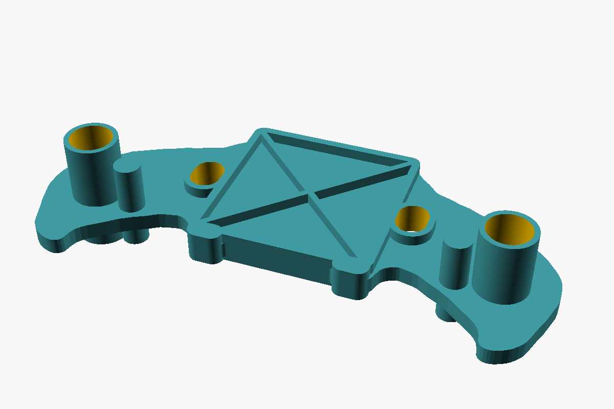
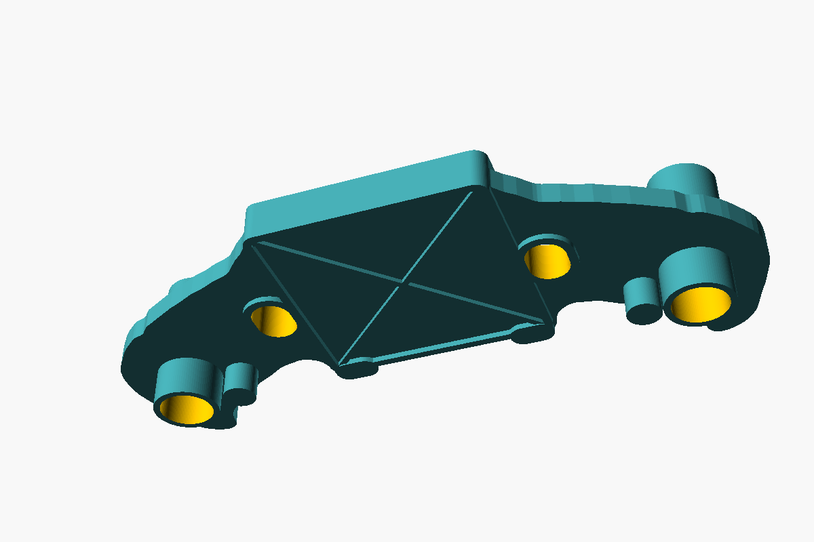
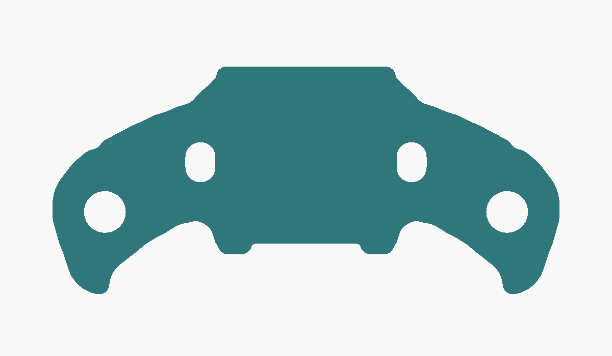

# Toy bracket replacement (parametric OpenSCAD)

A 3D-printable replacement for a broken plastic bracket from a child's toy, reverse-engineered from a
set of phone photos with caliper readings. The model is fully parametric: every dimension is a named
variable in [`src/toy_bracket.scad`](src/toy_bracket.scad).

> **Status: v2.** The v1 fit template was laid on the original. The outline, slots and tube matched, and the pin
> was about 1 mm off (photos 20 and 21). v2 fixes the pin from a caliper reading and uses measured tube and pin
> diameters. Still guessed: tube and pin **lengths**, rib heights and a few cosmetic details (all listed in
> [`docs/assumptions.md`](docs/assumptions.md)). A quick v2 fit template print is recommended before the real part.

| Face B (long tubes, deep X-ribbed square) | Face A (short tubes, flat square with thin X) |
|---|---|
|  |  |

## The part

- Flat web, **3.06 mm** thick, mirror-symmetric about its centre.
- A square plate in the middle (≈ 34 × 33.7 mm) with an X: deep X-ribbed pockets on face B, a thin raised X on face A.
- Two oval slots, one on each side of the square (5.7 × 7.6 mm, 40.0 mm apart).
- Two curved arms that end in a hook. Each arm has a **through tube** (Ø 9.83, bore 7.9) and a **solid pin**
  (Ø 4.92) right next to it, both sticking out on both faces (longer on face B).
- Small rounded tabs on the two square corners on the hook side.

In the toy, the part sits in an orange half-shell: the shell's posts go through the oval slots and into the
tube bores (photo 20).

One arm broke off (the fragment with its tube and pin survived, see photos 11 and 12). The model is built
from the intact arm and mirrors it to the other side.

Overall size: **96.1 × 43.3 mm**, 21.1 mm tall at the tubes (tube length still a guess).

## Files

| Path | What |
|---|---|
| `src/toy_bracket.scad` | The model. All parameters at the top, with source/confidence comments. |
| `src/arm_outline.scad` | Generated outline of one arm (traced from photo 01). Don't edit by hand. |
| `stl/toy_bracket.stl` | Ready-to-print part (current defaults). |
| `stl/toy_bracket_fit_template.stl` | 1 mm flat outline with all holes, for a quick fit check. |
| `docs/measurements.md` | Every caliper reading, what it measures and how it is used. |
| `docs/assumptions.md` | Every guess, why, and how to verify it. **Read this before printing.** |
| `docs/derivation.md` | How the outline was extracted from the photos (perspective correction etc.). |
| `docs/reference-photos/` | The original photos (cropped to the part). |
| `tools/render.sh` | Re-export STL files and preview images. |
| `tools/trace_outline.py` | Regenerates `src/arm_outline.scad` from photo 01. |
| `AGENTS.md` | Instructions for AI coding agents (Gemini CLI, Claude Code, Codex, Cursor…). |

## How to print

1. **Fit template first.** Print `stl/toy_bracket_fit_template.stl` (1 mm, a few minutes). Lay it on the
   original part (either face; flip it end-over-end, not side-to-side, the hooks must point the same way).
   The original tube and pin of the intact arm should pass through the template's holes (they are 0.4 mm
   oversize, `template_clearance`), and the outline should match the original's edge. If something is off,
   measure the offset and adjust the parameters (see below), then re-export.
2. **The bracket.** `stl/toy_bracket.stl` is exported face A down (short tubes on the bed, long tubes up).
   - The web sits 6 mm above the bed, so **enable supports** (tree supports, "on build plate only" is enough).
     If the supports under face A are a pain, set `face_a_details = false` (removes the cosmetic rim/X on face A;
     the tubes and pins stay).
   - Material: PETG or ABS/ASA if possible (tougher than PLA for a toy that already broke once). PLA works.
   - 4+ perimeters, 40–100 % infill, 0.2 mm layers or finer. It is small; 100 % infill is fine.
3. Check the fit on the toy's posts. If a tube is tight on its post, increase `tube_id` by 0.2 mm and re-export.
   If a tube is so long that the toy does not close, cut it down (or lower `tube_len_a` / `tube_len_b`).

## How to change something

Every dimension is a variable at the top of `src/toy_bracket.scad`. Three ways to change it:

- **OpenSCAD GUI:** open `src/toy_bracket.scad`, use *Window → Customizer*, then *Render (F6)* and *Export STL*.
- **Edit the file** and run `tools/render.sh` (macOS/Linux) to regenerate the STLs and previews.
- **Command line, no edits:**
  `openscad -D tube_id=7.2 -D 'part="bracket"' -o stl/toy_bracket.stl src/toy_bracket.scad`

Most likely to need a tweak:

| Parameter | Value | What |
|---|---|---|
| `tube_len_a` / `tube_len_b` | 6.0 / 12.0 | How far the tube sticks out of face A / face B (**guess**) |
| `peg_len_a` / `peg_len_b` | 4.5 / 9.0 | How far the pin sticks out of face A / face B (**guess**) |
| `tube_id` / `tube_od` | 7.9 / 9.83 | Tube bore / outside diameter (measured) |
| `peg_d` | 4.92 | Pin diameter (measured) |
| `tube_peg_span`, `tube_peg_angle` | 15.30, 191.7 | Pin position: far side of tube to far side of pin (measured), and direction (from photo 01) |
| `tube_x`, `tube_y` | 38.1, −9.45 | Tube centre (±x, mirrored) |
| `slot_c2c`, `slot_len_x`, `slot_len_y` | 40.0, 5.7, 7.6 | Oval slots |
| `web_t` | 3.06 | Web thickness (measured) |
| `face_b_frame_h` | 2.05 | Height of the square frame / X ribs on face B |
| `arm_outline_scale` | [1, 1] | Scale only the traced arm outline (x, y) |

## Measurements that would remove the biggest guesses

In order of impact (each one maps to a parameter; details in [`docs/assumptions.md`](docs/assumptions.md)):

1. Tube length: total tip to tip (outside jaws along the tube), and from the face A web surface to the tip
   (depth rod) → `tube_len_a`, `tube_len_b`.
2. The same two lengths on the pin → `peg_len_a`, `peg_len_b`.
3. Slot length along the long axis (inside jaws) → `slot_len_x`, and then `slot_c2c = 34.27 + slot_len_x`.
4. Height of the square frame on face B and of the rim on face A (depth rod) → `face_b_frame_h`, `face_a_rim_h`.

## Working with an AI agent

Open the repo in your agent of choice (Gemini CLI, Claude Code, Codex, Cursor…) and tell it what you measured,
e.g. *"the tube is 18.4 mm tip to tip and sticks out 5.2 mm on face A, update the model and re-export"*.
[`AGENTS.md`](AGENTS.md) tells the agent what to install, which parameter is which, and how to verify its change.
`GEMINI.md` and `CLAUDE.md` just import `AGENTS.md`.

## Why OpenSCAD and not Blender

This part is prismatic: a flat web plus cylinders, ribs and slots. That is exactly what OpenSCAD's
constructive solid geometry is good at. OpenSCAD also gives you:

- **Real parameters.** Named variables, a Customizer UI, and `-D` overrides from the command line.
- **Plain text.** Any LLM can read and edit it reliably, and `git diff` shows exactly what changed.
- **Headless rendering.** STL and PNG come straight from the command line, so an agent can iterate
  without a GUI or an MCP bridge.

Blender (with or without Blender MCP) is the better tool for organic, sculpted shapes. Here it would mean a
binary `.blend` as the source of truth, less robust mesh booleans, and a running Blender + MCP setup.
The only freeform curve in this part, the hook outline, is a polygon traced from a photo
(`src/arm_outline.scad`).
