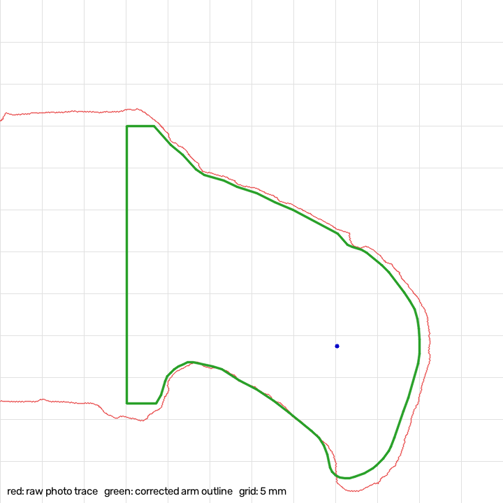

# How the outline was derived from the photos

The hooked arms are a freeform curve that a handful of caliper readings cannot describe. So the outline was
traced from a photo and then corrected with the caliper readings. This file explains how, so the result can be
trusted (or redone) by someone else. The code is [`tools/trace_outline.py`](../tools/trace_outline.py).



*Red: raw outline from photo 01 after perspective correction (only the intact half is used). Green: final
arm outline after scaling and hook correction. Blue dot: tube bore centre seen in the photo. Grid: 5 mm.*

## Pipeline

1. **Mat grid → homography.** The cutting mat has a 10 mm grid. Grid-line intersections are found
   automatically on clean mat next to the part (108 intersections, mean reprojection error 0.6 px ≈ 0.09 mm),
   and a homography maps photo pixels to millimetres on the mat plane.
2. **Rectify.** The region around the part is warped to a true top view at 10 px/mm.
3. **Segment.** The teal plastic is separated by colour (HSV). A 2 mm morphological closing fills small
   notches left by white stress marks. The outer contour and the holes are extracted.
4. **Part frame.** The two oval slots define the axis: origin midway between them, +x towards the intact arm,
   −y towards the hooks.
5. **Correct with caliper anchors** (see below).
6. **Arm polygon.** Only the intact arm (x ≥ 16.5 mm) is kept. The square plate, slots, tabs, tubes and pins
   are built from parameters in OpenSCAD instead. The arm is Gaussian-smoothed (σ ≈ 0.8 mm), resampled and
   simplified to ~60 points, then written to `src/arm_outline.scad`. OpenSCAD mirrors it for the other arm.

## Why a correction is needed: the part was not lying flat

With face A up, the part rests on the tip of its long face-B tube (~12 mm) at the arm end, so the arm end
is lifted. Anything above the mat plane looks bigger and is pushed away from the camera's nadir. The raw
traces show it clearly:

| | Photo 10 (top view on mat) | Photo 01 (in caliper) | Caliper |
|---|---|---|---|
| Slot centre distance (raw) | 40.55 | 40.97 | 34.27 + 5.7 = **40.0** (reading 40.37 by eye) |
| Overall width, hook tip → straight edge (raw) | 47.6 (**+10 %**) | 45.6 (**+5 %**) | **43.27** |
| X-rib angles relative to the slot axis | 45.7° / 133.0° | 45.7° / 133.0° | — |

- The **square/slot region is nearly undistorted** in both photos: the slot distance is within 1–2 % of the
  caliper, and the X-rib angles are identical in two photos taken from different positions.
- The **hook region is strongly distorted**, and differently in each photo. For photo 10 the camera was estimated
  ~14 cm above the mat; a lift of ~15 mm at the hook (tube 12 mm + web 3 mm) explains the +10 %.

## The correction applied

1. **Uniform scale** so that the slot centre distance equals `OVAL_C2C` = 40.0 mm. Photo 01: × 0.976.
2. **Hook compression.** Only the part of the arm that sticks out beyond the hook-side edge of the square
   (y below −15.5) is scaled in y, so that hook tip → straight edge = `OVERALL_WIDTH` = 43.27 mm.
   Photo 01: × 0.93 on that overhang.

Photo 01 is the primary source because its distortion was the smaller of the two (+5 %).

## Cross-checks

| Check | Model | Independent value |
|---|---|---|
| Tube centre (x, y) | (38.1, −9.45) | photo 01: (38.23, −9.27) · photo 10: (37.6, −9.45) · reading 4 with a 7.0 bore: (38.45, −9.61) |
| Slot inner edges | 34.3 | reading 2: 34.27 |
| Slot ↔ bore, edge to edge | 13.76 | reading 4: 14.15 (bore size is a guess) |
| Total thickness at the square | 5.91 | reading 7: 5.91 (used as an input) |

## Limitations

- The arm end can also be displaced **along x** by the lift, by an amount that depends on where the camera was.
  The three tube-position estimates spread over ≈ 0.85 mm in x, so expect up to ±1 mm there.
- The silhouette mixes top and bottom edges of a 3 mm web, which adds about ±0.2 mm.
- Phone lens distortion is not modelled. The grid fit residual (0.6 px) suggests it is small near the part.

## Re-running

```bash
python3 -m venv .venv && .venv/bin/pip install -r tools/requirements.txt
.venv/bin/python tools/trace_outline.py
tools/render.sh
```

To use different anchors (e.g. after measuring the slot length), edit `OVAL_C2C` / `OVERALL_WIDTH` at the top
of `tools/trace_outline.py`, re-run, and keep `slot_c2c` in `src/toy_bracket.scad` equal to `OVAL_C2C`.
